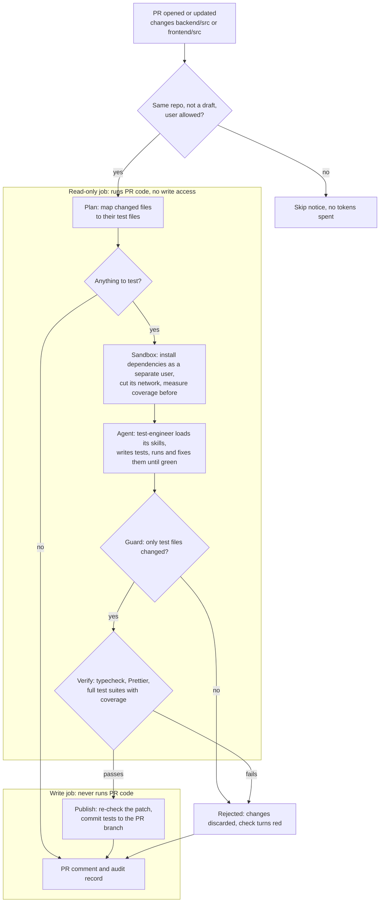

# PR Test Agent

- **What it does:** when a pull request changes `backend/src` or `frontend/src`, a Claude Code agent (the **test-engineer**) writes or updates unit tests for the changed code.
- **Who checks it:** a GitHub Actions workflow checks the tests, runs them, commits them to the PR branch and posts the results as a PR comment.
- **Coverage first:** I used the same agent and skills to fill the gaps in the existing test suite:

  | Area | Tests | Line coverage |
  | --- | --- | --- |
  | Backend | 58 → 107 | 55.6% → 93.7% |
  | Frontend | 23 → 83 | 55.3% → 97.5% |

- **Bugs found on the way:** writing those tests uncovered four small bugs, all fixed.
- **Extras:** things I built for fun are listed in [SOLUTION_EXTENDED.md](SOLUTION_EXTENDED.md).

## How it works

## 1. Main technical decisions

- **Claude Code as the agent environment**
  - Runs through the official `anthropics/claude-code-action`, pinned to a commit.
  - The agent works in a loop: it reads the code, writes a test, runs it, reads the failure and fixes it. A single model call that returns a diff can't check its own work.
  - Agents and skills are plain Markdown files, so the same setup works locally too.
- **The agent proposes, the workflow decides**
  - Everything around the agent is ordinary, tested TypeScript in [scripts/pr-agent](scripts/pr-agent): planning, policy checks, verification, reporting.
  - All pass/fail and coverage numbers in the PR come from the workflow's own run, not from the agent.
- **Security in layers**, because the agent reads untrusted PR content:
  - **Limited tools:** no web access. The shell is limited to the test runner, the formatter and read-only git. Reading `/proc` and the runner's dotfiles is denied.
  - **Guard:** the run is discarded if anything other than test files changed, and the patch is checked again before it's committed.
  - **Rules from the base branch:** agent instructions, permissions and checking code always come from the base branch, so a PR can't loosen them.
  - **Sandbox:** installs and tests run as a separate Linux user, with no secrets and no network.
  - **Write access kept apart:** the trigger is `pull_request`. The job that runs PR code is read-only, and the job that pushes never runs PR code.
  - **Allowlist:** only listed users (by default the owner) can start the agent. Everyone else, bots included, is skipped.
- **Delivery:** tests are committed to the PR branch. The agent only touches test files, and you review them in the same PR before merging.
- **Standards:** generated tests must pass the strict typecheck and Prettier, and follow the nine quality rules in section 3. Anything else is rejected.
- **Bounded and traceable runs:**
  - capped at 40 turns and 15 minutes
  - tokens reported in the PR comment and the commit message, plus the estimated cost on Claude
  - an audit record for every run

## 2. How to run the PR workflow

**Prerequisites**
1. This code on the repository's default branch.
2. The model's credential as a repository secret (see "Secrets" below).
3. The agent chosen in [.github/pr-agent/pr-agent.env](.github/pr-agent/pr-agent.env). Claude Code is the default.

**Choosing the agent**

Set the three agent lines in `pr-agent.env`, add the matching secret, and push to the default branch:

| Agent | `PR_AGENT_ENGINE` | `PR_AGENT_API_BASE_URL` | `PR_AGENT_MODEL` | Repository secret |
| --- | --- | --- | --- | --- |
| **Claude, Pro or Max plan (default)** | `claude-code` | empty | `claude-sonnet-5-5` | `CLAUDE_CODE_OAUTH_TOKEN` |
| Claude, API key | `claude-code` | empty | `claude-sonnet-5-5` | `ANTHROPIC_API_KEY` |
| Google Gemini (paid tier) | `openai-compatible` | `https://generativelanguage.googleapis.com/v1beta/openai` | `gemini-3.8-flash` | `PR_AGENT_API_KEY` |
| OpenAI (ChatGPT models) | `openai-compatible` | `https://api.openai.com/v1` | `gpt-5` | `PR_AGENT_API_KEY` |
| Groq (free tier) | `openai-compatible` | `https://api.groq.com/openai/v1` | `openai/gpt-oss-120b` | `PR_AGENT_API_KEY` |
| OpenRouter (`:free` models) | `openai-compatible` | `https://openrouter.ai/api/v1` | `qwen/qwen3-coder:free` | `PR_AGENT_API_KEY` |

- **More presets:** Mistral, DeepSeek, xAI and self-hosted servers are listed at the bottom of `pr-agent.env`.
- **Free tiers:** a run makes one request per agent turn, usually 20–40.
  - Gemini's free tier allows 20 requests a day for `gemini-3.8-flash`, so it can't finish a run. Enable billing on the key.
  - Check any provider's daily request limit before relying on its free tier.
- **Model IDs change:** if a run fails with HTTP 404, the PR comment quotes the provider's message, which usually names the replacement model.
- **Other Claude models:** `claude-opus-5-5` suits harder PRs and `claude-haiku-5-5` costs less.

**Switching from Gemini (or any other model) to Claude**
1. In `pr-agent.env`, set:
   - `PR_AGENT_ENGINE=claude-code`
   - `PR_AGENT_API_BASE_URL=`
   - `PR_AGENT_MODEL=claude-sonnet-5-5`
2. Make sure the secret `CLAUDE_CODE_OAUTH_TOKEN` (or `ANTHROPIC_API_KEY`) exists. `PR_AGENT_API_KEY` can stay; it's ignored.
3. Delete any repository variables named `PR_AGENT_ENGINE`, `PR_AGENT_API_BASE_URL` or `PR_AGENT_MODEL`, since they override the file.
4. Push to the default branch, then push to the PR (an empty commit is enough) to run it again.

Going the other way works the same: copy a row from the table, and add `PR_AGENT_API_KEY`.

**Secrets**

Add them under the repository's **Settings → Secrets and variables → Actions → Secrets → New repository secret**.

| Secret | Needed for | Where to get it |
| --- | --- | --- |
| `CLAUDE_CODE_OAUTH_TOKEN` | Claude, Pro or Max plan | Run `claude setup-token` |
| `ANTHROPIC_API_KEY` | Claude, API billing | console.anthropic.com |
| `PR_AGENT_API_KEY` | every `openai-compatible` agent | The provider's console, e.g. Google AI Studio for Gemini |

- **Never in files:** keys live only in GitHub secrets. The settings check rejects any unknown name in `pr-agent.env`, such as `PR_AGENT_API_KEY`.
- **Only the agent step sees them,** and never the sandboxed install and test runs.
- **Not for forks:** GitHub gives fork PRs no secrets, and the workflow skips them.
- **Base URL locked:** the API address comes from the base branch, so a PR can't redirect the key to another server.

**Other settings**
- **Same file:** they also live in `pr-agent.env`, and the workflow reads it from the base branch.
- **Overrides:** a repository variable with the same name overrides the file, for switching without a commit.
- **Checked first:** values are validated before the agent starts. An unknown key, a key set twice or a bad value fails the run with a clear message.

| Setting | Default | Purpose |
| --- | --- | --- |
| `PR_AGENT_ENGINE` | `claude-code` | `openai-compatible` runs the agent on any model with an OpenAI-style API |
| `PR_AGENT_API_BASE_URL` | empty | The model API's address, for the `openai-compatible` engine |
| `PR_AGENT_MODEL` | `claude-sonnet-5-5` | The model the agent runs on |
| `PR_AGENT_MAX_TURNS` | `40` | The agent's turn limit |
| `PR_AGENT_TIMEOUT_MINUTES` | `15` | The agent's time limit, at most 25 |
| `PR_AGENT_AUTO_COMMIT` | `true` | `false` gives a patch file instead of a commit |
| `PR_AGENT_KEEP_TRANSCRIPT` | `false` | `true` keeps the agent's full transcript for 14 days. Best on private repositories |

`PR_AGENT_ALLOWED_USERS` is the one exception: it stays a repository variable, because GitHub checks it before any code is checked out. It lists the GitHub logins allowed to start the agent, comma-separated, and defaults to the repository owner.

**Trigger:** open or update a non-draft PR, from a branch in the same repository, that changes app source.

**What every run leaves**
- **PR comment,** updated in place: the decision, the skills used, the test files, a typecheck, format, tests and coverage table, and the usage.
- **Commit** with the verified tests, or a red check explaining why there isn't one.
- **`pr-agent-results` artifact** with the raw files, kept 14 days.
- **`pr-agent-audit` artifact,** kept 90 days: who ran it, on which commits, with which model and limits, what changed, the verification result, the cost and the outcome.

### Using other models or providers

What carries over unchanged in every case:
- **The deterministic tooling:** planner, guard, sandbox, verification, report and audit.
- **The skills' content:** what to test, how, and what a good test is.
- **The workflow's security setup.**

Only the engine, the model and its credentials change.

**1. Another Claude model.** No code change.
- Set `PR_AGENT_MODEL` to another Claude model ID, for example a larger model for harder PRs or a smaller one to save cost.
- Prerequisite: your plan or API key has access to that model.

**2. Any other model: ChatGPT, Gemini, Llama and others.** Built in, no code change.
- **How:** the `openai-compatible` engine is a small agent loop of our own in [scripts/pr-agent/lib/agent-loop.ts](scripts/pr-agent/lib/agent-loop.ts). It talks to any API that follows OpenAI's chat-completions format with tool calling, which most providers offer.
- **Same agent, same skills:** it reads the same `test-engineer.md` and skills, and the model loads skills through a `load_skill` tool.
- **Same boundaries, enforced in code:** no web or shell access. Files can be read except `.env`, `.git` and `node_modules`, writes are limited to test files, and commands go through the sandboxed runner. The guard and verification run after it as usual.
- **Setup:** pick a row from "Choosing the agent" above.
- **Reliability:** busy or rate-limited providers (HTTP 429, 5xx) are retried up to five times with growing delays. Any other error stops the run, and the PR comment quotes it.
- **Prerequisites:**
  - the model supports tool calling
  - a request quota of at least 40 requests per run
  - the provider's terms allow sending your code to it
- **Trade-offs:**
  - Claude Code's own tooling (subagents, file editing by diff, prompt caching) isn't available, so runs can cost more tokens.
  - Quality depends on the model. Weaker models abstain or get rejected more often, but never commit unverified tests.
  - The testability agent still needs the `claude-code` engine.
  - Re-run the example PR and compare decision quality, cost and run time before switching for real.

## 3. Where the agent and skills are defined, and how they're used

| What | Where | Role in a run |
| --- | --- | --- |
| `test-engineer` agent | [.claude/agents/test-engineer.md](.claude/agents/test-engineer.md) | Analyses the change, writes tests, verifies them, and reports in a fixed JSON format |
| `pr-change-analysis` skill | [.claude/skills/pr-change-analysis](.claude/skills/pr-change-analysis/SKILL.md) | Decides for each changed file whether to write a test, update one or skip it, and why |
| `unit-test-quality` skill | [.claude/skills/unit-test-quality](.claude/skills/unit-test-quality/SKILL.md) | What a good unit test is |
| `backend-unit-tests` skill | [.claude/skills/backend-unit-tests](.claude/skills/backend-unit-tests/SKILL.md) | This repo's backend test conventions: what to fake and how |
| `frontend-unit-tests` skill | [.claude/skills/frontend-unit-tests](.claude/skills/frontend-unit-tests/SKILL.md) | This repo's frontend test conventions: what to mock and how |
| `test-verification` skill | [.claude/skills/test-verification](.claude/skills/test-verification/SKILL.md) | The run-fix-repeat loop, formatting and typecheck |
| Workflow | [.github/workflows/pr-agents.yml](.github/workflows/pr-agents.yml) | Runs everything and enforces the boundaries |
| Tooling | [scripts/pr-agent/](scripts/pr-agent) | Planner, guard, sandboxed runner, report, audit record and the `openai-compatible` agent loop. A separate TypeScript package with its own tests |

**A run, step by step** (the graph above):
1. **Plan:** map each changed source file to its test file, skipping files with nothing to test.
2. **Agent:** load the skills, write the tests, run them until they're green.
3. **Guard:** only test files may have changed.
4. **Verify:** run the typecheck, Prettier and the full suites with coverage again.
5. **Publish:** commit the tests, update the comment, write the audit record.

**A good unit test,** as defined by the `unit-test-quality` skill:
1. checks one behaviour, and its name says which
2. uses the public interface only
3. fails if the code it checks breaks
4. compares against fixed expected values, with strict matchers
5. covers the edge cases
6. only fakes the outside world: network, database, clock
7. is isolated and deterministic
8. is readable, with no logic and nothing skipped
9. passes the typecheck and the formatter without `@ts-ignore` or `as any`

## 4. Example run

**The PR:** [PR #2](https://github.com/Marcinthedev/taskly-pr-agent-playground/pull/2) adds a "Clear completed tasks" feature with no tests:
- **Backend:** a route and a repository method.
- **Frontend:** an API call, a mutation hook, a header button and the page wiring.
- **Breakage:** it also breaks two existing tests on purpose.

**What happened**
- **Plan:** 7 changed files mapped to their test files. `openapi.json` and `types.ts` ignored.
- **Agent decision:** `tests_added`.
- **Skills used:** `pr-change-analysis`, `unit-test-quality`, `backend-unit-tests`, `frontend-unit-tests`, `test-verification`.
- **Tests written:** 7 files and 242 lines, committed as `f0f1ddb`.
  - **Repaired:** the router test's fake and the page test's missing mock.
  - **New route:** 200 with `{ deleted }`, not routed as an id, 500 on failure.
  - **Everything else:** the repository query, the API call, the hook's cache update, the header button's states, and the page's notices and guards.

**Verification by the workflow**

| Area | Typecheck | Tests | Line coverage |
| --- | --- | --- | --- |
| backend | ✅ | 114 / 114 passed | 92.5% → 93.8% |
| frontend | ✅ | 100 / 100 passed | 83.1% → 97.8% |

**Notes**
- The frontend's low starting coverage comes from the two tests the feature broke.
- **Lessons fed back into the agent:**
  - The agent tested a constants file by restating the constant, so the planner now skips constants files.
  - The usage line only counted the coordinating agent, so it now counts all of them.

## 5. Assumptions

- PRs come from branches in the same repository, and their authors are trusted to run code in CI.
- Tests use the existing stack (Vitest, supertest, Testing Library) and need no database or network.
- One test file per source file is a sensible default.

## 6. Limitations

- **Passing doesn't mean useful.** The quality rules make weak tests less likely, but only a human review catches them for sure.
- **No coverage gate on changed lines.** If the agent wrongly decides a change needs no tests, nothing flags it.
- **Fork PRs are skipped,** because they get no secrets.
- **Large PRs** can hit the turn or time limit. The run then fails cleanly, and normal CI isn't affected.
- **No secret scan.** The patch isn't scanned for secrets before it's committed.
- **The `openai-compatible` engine has no completed real run yet.**
  - It's covered by unit tests and a local smoke test with a fake provider.
  - On GitHub Actions, Gemini accepted the settings, the key and the request format, and answered the agent's first turns.
  - The test runs were stopped by the provider, never by the workflow:
    - a retired model ID (HTTP 404)
    - an overload (HTTP 503)
    - the free tier's daily cap of 20 requests (HTTP 429)
  - Each error is quoted in the PR comment, and overloads and rate limits are retried.
  - A full Gemini run needs a paid tier. The example run in section 4 used Claude Code.

## 7. What I'd change for production

- **Prove the tests matter:**
  - run each new test against the code before the change, where it should fail
  - a coverage gate on changed lines
  - mutation testing
- **Credentials:**
  - scan each patch for secrets
  - replace the static token with short-lived credentials (workload identity federation)
- **Spend fewer tokens:**
  - only look at commits since the last run
  - give the agent the context it needs up front, instead of letting it search
- **Improve testability, not just tests:** some code is hard to test because of how it's written. I built a second agent for this. It pulls logic out into small, pure functions and opens the result as a separate PR. It's switched off for now; see [SOLUTION_EXTENDED.md](SOLUTION_EXTENDED.md).
- **Reuse and observability:**
  - a per-repo config file, so other projects can use the agent without code changes
  - audit records sent to a central log store
