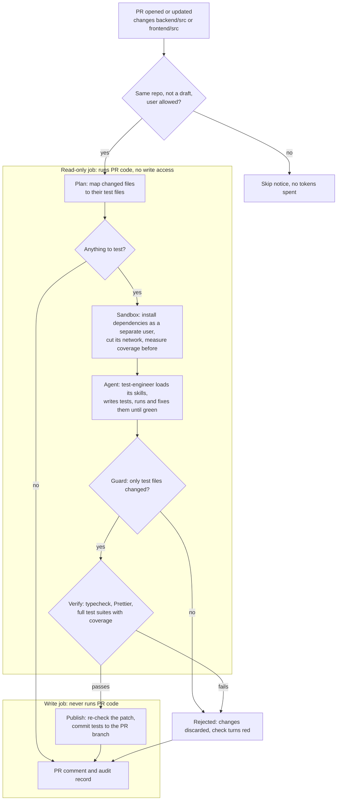

# PR Test Agent

When a pull request changes `backend/src` or `frontend/src`, a Claude Code agent (the **test-engineer**) writes or updates unit tests for the changed code. A GitHub Actions workflow then checks and runs those tests, commits them to the PR branch and posts the results as a PR comment.

I first used the same agent and skills to fill the gaps in the existing test suite. Writing those tests uncovered four small bugs, all fixed.

| Area | Tests | Line coverage |
| --- | --- | --- |
| Backend | 58 → 107 | 55.6% → 93.7% |
| Frontend | 23 → 83 | 55.3% → 97.5% |

Things I built for fun are listed in [SOLUTION_EXTENDED.md](SOLUTION_EXTENDED.md).

## How it works

## 1. Main technical decisions

- **Claude Code as the agent.** It runs through the official `anthropics/claude-code-action`, pinned to a commit. It works in a loop: read the code, write a test, run it, fix the failure. A single model call that returns a diff can't check its own work. The agent and skills are Markdown files, so the same setup works locally.
- **The agent proposes, the workflow decides.** Planning, policy checks, verification and reporting are tested TypeScript in [scripts/pr-agent](scripts/pr-agent). Every pass/fail and coverage number in the PR comes from the workflow, not the agent.
- **Security in layers,** because the agent reads untrusted PR content:
  - No web access. The shell only runs the test runner, the formatter and read-only git. Reading `/proc` and the runner's dotfiles is denied.
  - The guard discards the run if anything but test files changed, and the patch is checked again before the commit.
  - Agent instructions, permissions and the checking code come from the base branch, so a PR can't loosen them.
  - Installs and tests run as a separate Linux user, with no secrets and no network.
  - The trigger is `pull_request`. The job that runs PR code is read-only, and the job that pushes never runs PR code.
  - Only allowed users (by default the owner) can start the agent. Everyone else, bots included, is skipped.
- **Delivery:** tests are committed to the PR branch, so you review them in the same PR before merging.
- **Standards:** tests must pass the strict typecheck and Prettier and follow the nine quality rules in section 3, or they're rejected.
- **Limits and tracing:** 40 turns and 15 minutes per run. Tokens are reported in the PR comment and the commit message, with the estimated cost on Claude. Every run writes an audit record.

## 2. How to run the PR workflow

**Prerequisites**
1. This code on the repository's default branch.
2. The model's credential as a repository secret (see "Secrets").
3. The model chosen in [.github/pr-agent/pr-agent.env](.github/pr-agent/pr-agent.env). Claude Code is the default.

**Trigger:** open or update a non-draft PR from a branch in the same repository that changes app source.

**Choosing the model:** set the three agent lines in `pr-agent.env`, add the matching secret, and push to the default branch.

| Model | `PR_AGENT_ENGINE` | `PR_AGENT_API_BASE_URL` | `PR_AGENT_MODEL` | Secret |
| --- | --- | --- | --- | --- |
| **Claude, Pro or Max plan (default)** | `claude-code` | empty | `claude-sonnet-5-5` | `CLAUDE_CODE_OAUTH_TOKEN` |
| Claude, API key | `claude-code` | empty | `claude-sonnet-5-5` | `ANTHROPIC_API_KEY` |
| Google Gemini (paid tier) | `openai-compatible` | `https://generativelanguage.googleapis.com/v1beta/openai` | `gemini-3.8-flash` | `PR_AGENT_API_KEY` |
| OpenAI (ChatGPT models) | `openai-compatible` | `https://api.openai.com/v1` | `gpt-5` | `PR_AGENT_API_KEY` |
| Groq (free tier) | `openai-compatible` | `https://api.groq.com/openai/v1` | `openai/gpt-oss-120b` | `PR_AGENT_API_KEY` |
| OpenRouter (`:free` models) | `openai-compatible` | `https://openrouter.ai/api/v1` | `qwen/qwen3-coder:free` | `PR_AGENT_API_KEY` |

- Presets for Mistral, DeepSeek, xAI and self-hosted servers are at the bottom of `pr-agent.env`.
- Other Claude models: `claude-opus-5-5` for harder PRs, `claude-haiku-5-5` to save cost.
- A run makes one request per agent turn, usually 20–40. Gemini's free tier allows 20 a day, so it can't finish a run. Check a provider's daily limit before relying on its free tier.
- Model IDs change. On HTTP 404, the PR comment quotes the provider's message, which usually names the replacement.
- To switch back to Claude, set the Claude row and make sure its secret exists. Delete any repository variables named like the three settings, since they override the file. Then push to the default branch and push to the PR again (an empty commit is enough).

**Secrets:** add them under *Settings → Secrets and variables → Actions → Secrets*.

| Secret | Needed for | Where to get it |
| --- | --- | --- |
| `CLAUDE_CODE_OAUTH_TOKEN` | Claude, Pro or Max plan | `claude setup-token` |
| `ANTHROPIC_API_KEY` | Claude, API billing | console.anthropic.com |
| `PR_AGENT_API_KEY` | every `openai-compatible` model | the provider's console, e.g. Google AI Studio |

Keys live only in secrets. The settings check rejects unknown names in `pr-agent.env`, such as `PR_AGENT_API_KEY`. Only the agent step sees the keys, never the sandboxed installs and tests. Fork PRs get no secrets and are skipped. The API address comes from the base branch, so a PR can't send the key elsewhere.

**Settings:** all in `pr-agent.env`, read from the base branch and validated before the agent starts. An unknown key, a key set twice or a bad value fails the run with a clear message. A repository variable with the same name overrides the file, for switching without a commit.

| Setting | Default | Purpose |
| --- | --- | --- |
| `PR_AGENT_ENGINE` | `claude-code` | `openai-compatible` runs the agent on any model with an OpenAI-style API |
| `PR_AGENT_API_BASE_URL` | empty | The model API's address, for `openai-compatible` |
| `PR_AGENT_MODEL` | `claude-sonnet-5-5` | The model |
| `PR_AGENT_MAX_TURNS` | `40` | Turn limit |
| `PR_AGENT_TIMEOUT_MINUTES` | `15` | Time limit, at most 25 |
| `PR_AGENT_AUTO_COMMIT` | `true` | `false` gives a patch file instead of a commit |
| `PR_AGENT_KEEP_TRANSCRIPT` | `false` | `true` keeps the full transcript for 14 days. Best on private repositories |

`PR_AGENT_ALLOWED_USERS` stays a repository variable, because GitHub checks it before any code is checked out. It's a comma-separated list of GitHub logins and defaults to the repository owner.

**What every run leaves**
- a PR comment, updated in place: the decision, skills used, test files, a typecheck/format/tests/coverage table, and usage
- a commit with the verified tests, or a red check saying why there isn't one
- a `pr-agent-results` artifact with the raw files, kept 14 days
- a `pr-agent-audit` artifact, kept 90 days: who ran it, on which commits, with which model and limits, what changed, the verification result, the cost and the outcome

### Other models

The tooling, the skills and the security setup stay the same for every model. Only the engine, the model and the secret change.

The `openai-compatible` engine is a small agent loop of our own in [scripts/pr-agent/lib/agent-loop.ts](scripts/pr-agent/lib/agent-loop.ts). It works with any API that follows OpenAI's chat-completions format with tool calling, which most providers offer.
- It uses the same `test-engineer.md` and skills. The model loads skills through a `load_skill` tool.
- Its limits are enforced in code: no web or shell access, no reading `.env`, `.git` or `node_modules`, writes only to test files, and commands only through the sandboxed runner. The guard and verification run after it as usual.
- Busy or rate-limited providers (HTTP 429, 5xx) are retried up to five times with growing delays. Any other error stops the run, and the PR comment quotes it.
- **Prerequisites:** the model supports tool calling, the quota allows at least 40 requests per run, and the provider's terms allow sending it your code.
- **Trade-offs:** no subagents, diff-based editing or prompt caching, so runs can cost more tokens. Quality depends on the model: weaker ones abstain or get rejected more often, but never commit unverified tests. The testability agent needs `claude-code`. Re-run the example PR and compare quality, cost and time before switching.

## 3. Where the agent and skills are defined, and how they're used

| What | Where | Role |
| --- | --- | --- |
| `test-engineer` agent | [.claude/agents/test-engineer.md](.claude/agents/test-engineer.md) | Analyses the change, writes and verifies tests, reports in a fixed JSON format |
| `pr-change-analysis` skill | [.claude/skills/pr-change-analysis](.claude/skills/pr-change-analysis/SKILL.md) | Decides per changed file: write a test, update one or skip, and why |
| `unit-test-quality` skill | [.claude/skills/unit-test-quality](.claude/skills/unit-test-quality/SKILL.md) | What a good unit test is |
| `backend-unit-tests` skill | [.claude/skills/backend-unit-tests](.claude/skills/backend-unit-tests/SKILL.md) | Backend test conventions: what to fake and how |
| `frontend-unit-tests` skill | [.claude/skills/frontend-unit-tests](.claude/skills/frontend-unit-tests/SKILL.md) | Frontend test conventions: what to mock and how |
| `test-verification` skill | [.claude/skills/test-verification](.claude/skills/test-verification/SKILL.md) | The run-fix-repeat loop, formatting and typecheck |
| Workflow | [.github/workflows/pr-agents.yml](.github/workflows/pr-agents.yml) | Runs everything and enforces the boundaries |
| Tooling | [scripts/pr-agent/](scripts/pr-agent) | Planner, guard, sandboxed runner, report, audit record and the `openai-compatible` loop. A separate TypeScript package with its own tests |

**A run** (the graph above):
1. **Plan:** map each changed source file to its test file, skipping files with nothing to test.
2. **Agent:** load the skills, write the tests, run them until they pass.
3. **Guard:** every changed file must be a test file in an area the PR changed, new or edited (not deleted or binary). At most 15 files, and nothing under `node_modules`. Any violation discards the whole run.
4. **Verify:** run the typecheck, Prettier and the full suites with coverage again.
5. **Publish:** re-check the patch, commit the tests, update the comment, write the audit record.

**A good unit test,** per the `unit-test-quality` skill:
1. checks one behaviour, and its name says which
2. uses the public interface only
3. fails if the code it checks breaks
4. compares against fixed expected values, with strict matchers
5. covers the edge cases
6. fakes only the outside world: network, database, clock
7. is isolated and deterministic
8. is readable, with no logic and nothing skipped
9. passes the typecheck and the formatter without `@ts-ignore` or `as any`

## 4. Example run

[PR #2](https://github.com/Marcinthedev/taskly-pr-agent-playground/pull/2) adds a "Clear completed tasks" feature with no tests: a backend route and repository method, and on the frontend an API call, a mutation hook, a header button and the page wiring. It also breaks two existing tests on purpose.

- **Plan:** 7 changed files mapped to their test files. `openapi.json` and `types.ts` ignored.
- **Decision:** `tests_added`
- **Skills used:** `pr-change-analysis`, `unit-test-quality`, `backend-unit-tests`, `frontend-unit-tests`, `test-verification`
- **Tests:** 7 files and 242 lines, committed as `f0f1ddb`:
  - repaired the router test's fake and the page test's missing mock
  - the new route: 200 with `{ deleted }`, not routed as an id, 500 on failure
  - the repository query, the API call, the hook's cache update, the header button's states, and the page's notices and guards

Verified by the workflow:

| Area | Typecheck | Tests | Line coverage |
| --- | --- | --- | --- |
| backend | ✅ | 114 / 114 passed | 92.5% → 93.8% |
| frontend | ✅ | 100 / 100 passed | 83.1% → 97.8% |

The frontend starts low because of the two tests the feature broke. Two lessons went back into the agent: it had tested a constants file by restating the constant, so the planner now skips constants files; and the usage line only counted the coordinating agent, so it now counts all of them.

## 5. Assumptions

- PRs come from branches in the same repository, and their authors are trusted to run code in CI.
- Tests use the existing stack (Vitest, supertest, Testing Library) and need no database or network.
- One test file per source file is a sensible default.

## 6. Limitations

- Passing doesn't mean useful. The quality rules make weak tests less likely, but only a human review catches them.
- No coverage gate on changed lines, so if the agent wrongly decides a change needs no tests, nothing flags it.
- Fork PRs are skipped, because they get no secrets.
- Large PRs can hit the turn or time limit. The run then fails cleanly, and normal CI isn't affected.
- The patch isn't scanned for secrets before it's committed.
- The `openai-compatible` engine has no completed real run yet. It has unit tests and a local smoke test with a fake provider. On GitHub Actions, Gemini accepted the settings, key and request format and answered the first turns. The runs were then stopped by the provider: a retired model ID (404), an overload (503) and the free tier's 20-requests-a-day cap (429). Each error was quoted in the PR comment. A full Gemini run needs a paid tier. The example run used Claude Code.

## 7. What I'd change for production

- **Prove the tests matter:** run each new test against the code before the change, where it should fail; a coverage gate on changed lines; mutation testing.
- **Credentials:** scan each patch for secrets; replace the static token with short-lived credentials (workload identity federation).
- **Spend fewer tokens:** only look at commits since the last run; give the agent the context it needs up front instead of letting it search.
- **Improve testability, not just tests:** some code is hard to test because of how it's written. A second agent I built pulls logic out into small, pure functions and opens the result as a separate PR. It's switched off; see [SOLUTION_EXTENDED.md](SOLUTION_EXTENDED.md).
- **Reuse and observability:** a per-repo config file so other projects can use the agent without code changes; audit records sent to a central log store.
